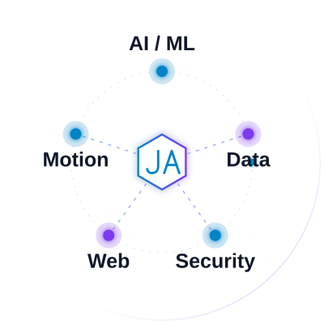
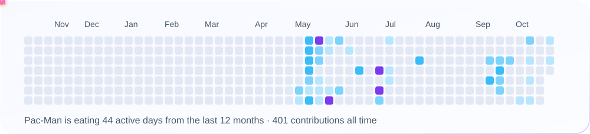

<picture>
  <source media="(prefers-color-scheme: dark)" srcset="art/header-dark.svg">
  
</picture>

<h1>Hey there, I'm Joey A 👋</h1>

  

 

<picture>
  <source media="(prefers-color-scheme: dark)" srcset="art/title-about-dark.svg">
  
</picture>

<picture>
  <source media="(prefers-color-scheme: dark)" srcset="art/focus-dark.svg">
  
</picture>

I'm a **student and working developer** who enjoys building across the stack: full-stack web apps, data science, AI, security, and motion graphics.

- 🌐 **Portfolio:** [joey-a.pages.dev](https://joey-a.pages.dev/)
- 🧠 **Exploring:** AI, machine learning and data-driven products
- 🔐 **Curious about:** security, how systems break and how to protect them
- 🎬 **Also into:** motion graphics and visual design
- 🚀 **Goal:** ship clean, useful software and keep leveling up
- 📫 **Reach me:** [joyeanil23@gmail.com](mailto:joyeanil23@gmail.com)

 

 

<picture>
  <source media="(prefers-color-scheme: dark)" srcset="art/title-stack-dark.svg">
  
</picture>

<b>Languages</b> 
<picture>
  <source media="(prefers-color-scheme: dark)" srcset="https://skillicons.dev/icons?i=cs,java,js,py,rust,cpp,html,css&perline=10&theme=dark">
  
</picture> 
C# · Java · JavaScript · Python · Rust · C++ · HTML5 · CSS3

<b>Motion Graphics &amp; Design</b> 
<picture>
  <source media="(prefers-color-scheme: dark)" srcset="https://skillicons.dev/icons?i=ae,pr,blender,figma&perline=10&theme=dark">
  
</picture> 
After Effects · Premiere Pro · Blender · Figma

<b>Web &amp; Databases</b> 
<picture>
  <source media="(prefers-color-scheme: dark)" srcset="https://skillicons.dev/icons?i=react,next,nodejs,express,fastapi,flask,tailwind,postgres,mongodb,mysql&perline=10&theme=dark">
  
</picture> 
React · Next.js · Node.js · Express · FastAPI · Flask · Tailwind CSS · PostgreSQL · MongoDB · MySQL

<b>Data &amp; AI</b> 
<picture>
  <source media="(prefers-color-scheme: dark)" srcset="https://skillicons.dev/icons?i=tensorflow,pytorch,sklearn,opencv,matlab,r&perline=10&theme=dark">
  
</picture> 
TensorFlow · PyTorch · scikit-learn · OpenCV · MATLAB · R

<b>Security, DevOps &amp; Tools</b> 
<picture>
  <source media="(prefers-color-scheme: dark)" srcset="https://skillicons.dev/icons?i=kali,linux,docker,git,github,ghactions,vscode,vercel,cloudflare&perline=10&theme=dark">
  
</picture> 
Kali Linux · Linux · Docker · Git · GitHub · GitHub Actions · VS Code · Vercel · Cloudflare

 

 

<picture>
  <source media="(prefers-color-scheme: dark)" srcset="art/title-terminal-dark.svg">
  
</picture>

 

<picture>
  <source media="(prefers-color-scheme: dark)" srcset="art/title-stats-dark.svg">
  
</picture>

<picture>
  <source media="(prefers-color-scheme: dark)" srcset="art/stats-dark.svg">
  
</picture>

 

<picture>
  <source media="(prefers-color-scheme: dark)" srcset="art/title-pacman-dark.svg">
  
</picture>

<picture>
  <source media="(prefers-color-scheme: dark)" srcset="art/pacman-dark.svg">
  
</picture>

 

<picture>
  <source media="(prefers-color-scheme: dark)" srcset="art/title-connect-dark.svg">
  
</picture>

 

