<picture>
  <source media="(prefers-color-scheme: dark)" srcset="art/header-dark.svg">
  
</picture>

<h1>Hey there, I'm Joey A 👋</h1>

  

 

<table>
<tr>
<td width="65%" valign="top">

### 👨‍💻 About Me

I'm a **student and working developer** who enjoys building across the stack: full-stack web apps, data science, AI, and security.

- 🌐 Portfolio: [joey-a.pages.dev](https://joey-a.pages.dev/)
- 🧠 Exploring: AI, machine learning and data-driven products
- 🔐 Curious about: security, how systems break and how to protect them
- 🚀 Goal: ship clean, useful software and keep leveling up
- 📫 Reach me: [joyeanil23@gmail.com](mailto:joyeanil23@gmail.com)

</td>
<td width="35%" align="center" valign="middle">

<picture>
  <source media="(prefers-color-scheme: dark)" srcset="art/about-dark.svg">
  
</picture>

</td>
</tr>
</table>

 

<h2 align="center">🛠️ Tech Stack</h2>

<b>Languages</b> 
<picture>
  <source media="(prefers-color-scheme: dark)" srcset="https://skillicons.dev/icons?i=cs,java,js,py,rust,cpp,html,css&perline=10&theme=dark">
  
</picture> 
C# · Java · JavaScript · Python · Rust · C++ · HTML5 · CSS3

<b>Motion Graphics &amp; Design</b> 
<picture>
  <source media="(prefers-color-scheme: dark)" srcset="https://skillicons.dev/icons?i=ae,pr,blender,figma&perline=10&theme=dark">
  
</picture> 
After Effects · Premiere Pro · Blender · Figma

<b>Web &amp; Databases</b> 
<picture>
  <source media="(prefers-color-scheme: dark)" srcset="https://skillicons.dev/icons?i=react,next,nodejs,express,fastapi,flask,tailwind,postgres,mongodb,mysql&perline=10&theme=dark">
  
</picture> 
React · Next.js · Node.js · Express · FastAPI · Flask · Tailwind CSS · PostgreSQL · MongoDB · MySQL

<b>Data &amp; AI</b> 
<picture>
  <source media="(prefers-color-scheme: dark)" srcset="https://skillicons.dev/icons?i=tensorflow,pytorch,sklearn,opencv,matlab,r&perline=10&theme=dark">
  
</picture> 
TensorFlow · PyTorch · scikit-learn · OpenCV · MATLAB · R

<b>Security, DevOps &amp; Tools</b> 
<picture>
  <source media="(prefers-color-scheme: dark)" srcset="https://skillicons.dev/icons?i=kali,linux,docker,git,github,ghactions,vscode,vercel,cloudflare&perline=10&theme=dark">
  
</picture> 
Kali Linux · Linux · Docker · Git · GitHub · GitHub Actions · VS Code · Vercel · Cloudflare

 

<h2 align="center">📊 GitHub Stats</h2>

<picture>
  <source media="(prefers-color-scheme: dark)" srcset="https://github-readme-stats.vercel.app/api?username=joeyanil&show_icons=true&hide_border=true&border_radius=16&bg_color=0B1020&title_color=38BDF8&icon_color=8B5CF6&text_color=C7D2FE&ring_color=38BDF8&count_private=true&include_all_commits=true">
  
</picture>
<picture>
  <source media="(prefers-color-scheme: dark)" srcset="https://github-readme-stats.vercel.app/api/top-langs/?username=joeyanil&layout=compact&hide_border=true&border_radius=16&bg_color=0B1020&title_color=38BDF8&text_color=C7D2FE&langs_count=8">
  
</picture>

 

<picture>
  <source media="(prefers-color-scheme: dark)" srcset="https://streak-stats.demolab.com?user=joeyanil&hide_border=true&border_radius=16&background=0B1020&ring=38BDF8&fire=8B5CF6&currStreakLabel=38BDF8&currStreakNum=FFFFFF&sideNums=FFFFFF&sideLabels=C7D2FE&dates=94A3B8">
  
</picture>

 

<picture>
  <source media="(prefers-color-scheme: dark)" srcset="https://github-readme-activity-graph.vercel.app/graph?username=joeyanil&bg_color=0B1020&color=C7D2FE&line=38BDF8&point=8B5CF6&area=true&area_color=8B5CF6&hide_border=true&hide_title=true">
  
</picture>

 

<h2 align="center">🐍 Contribution Snake</h2>

<!--
  SNAKE SETUP (one-time):
  1. Keep .github/workflows/snake.yml from this folder in your profile repo.
  2. Repo Settings -> Actions -> General -> Workflow permissions -> "Read and write permissions".
  3. Go to the Actions tab -> "Generate Contribution Snake" -> Run workflow.
  4. It creates an "output" branch with the SVGs used below, and refreshes every 12 hours.
-->

<picture>
  <source media="(prefers-color-scheme: dark)" srcset="https://raw.githubusercontent.com/joeyanil/joeyanil/output/github-snake-dark.svg">
  <source media="(prefers-color-scheme: light)" srcset="https://raw.githubusercontent.com/joeyanil/joeyanil/output/github-snake.svg">
  
</picture>

 

<h2 align="center">🤝 Connect With Me</h2>

 

